# Evidencia visual del cierre F4

El movimiento es el CP02 aprobado; CP03 solo actualiza metadatos y registra el cierre. Las capturas del portable se obtuvieron en un contexto de navegador sin conexión con el HTML extraído cargado en memoria; `file://` nativo fue bloqueado por la política del entorno. Ver el [informe de método y límites](INFORME_CIERRE.md).

El [vídeo comparativo CP02](../revision-cp02/evidencias/F4_CP02_ANTES_DESPUES.mp4) conserva el movimiento aprobado y sus estados de ida y vuelta. Su etiqueta «pendiente» es histórica; la aprobación del usuario se registra en [APROBACION_F4.md](APROBACION_F4.md).

## Escritorio 1440×900

### 0 %

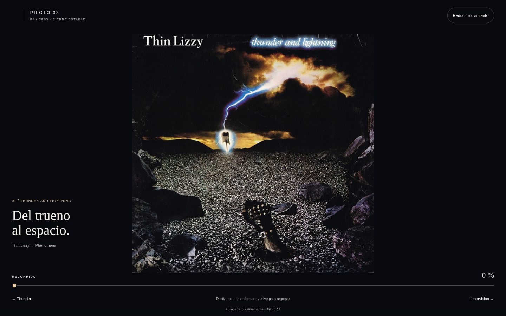

### 25 %

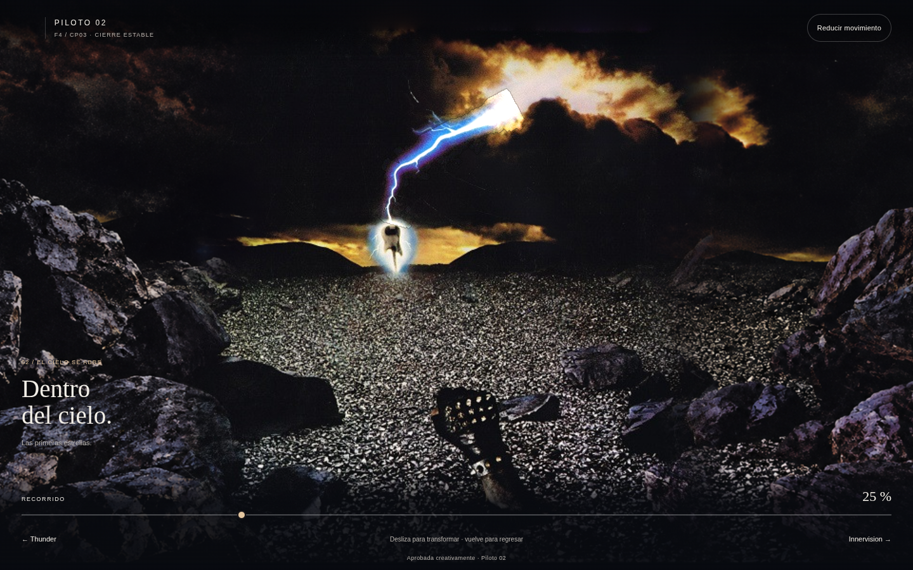

### 50 %

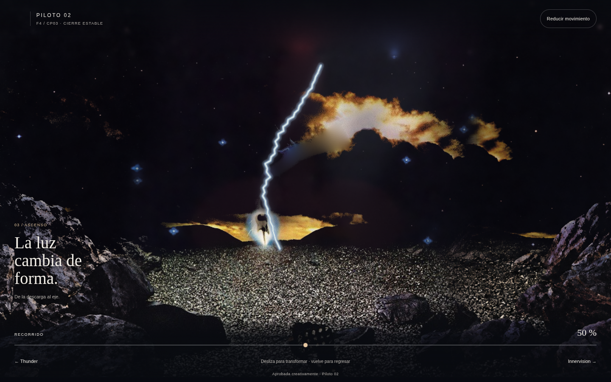

### 75 %

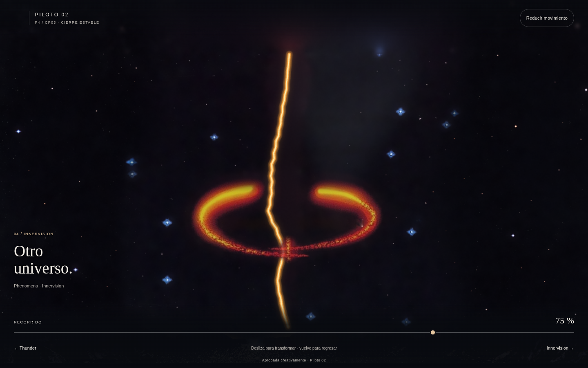

### 90 %

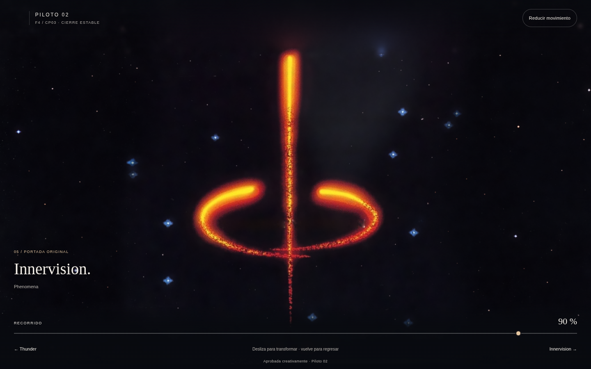

### 100 %

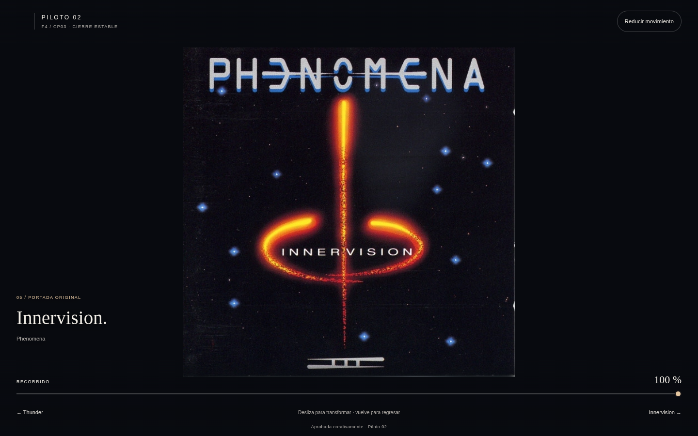

## Móvil emulado 390×844

### 0 %

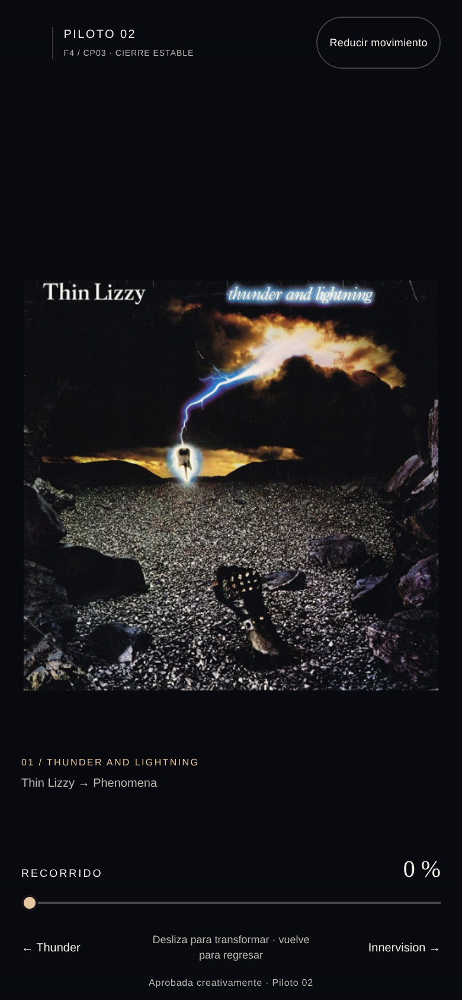

### 25 %

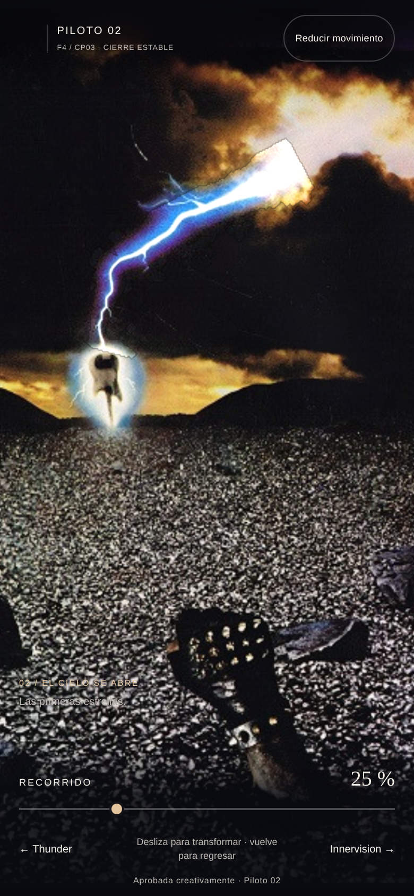

### 50 %

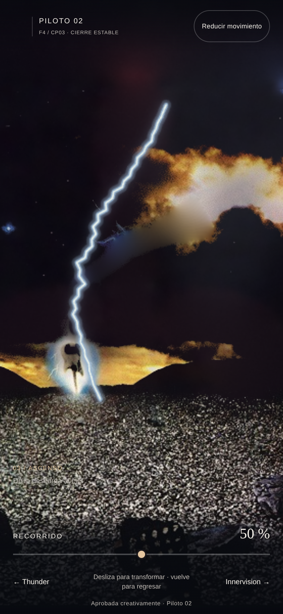

### 75 %

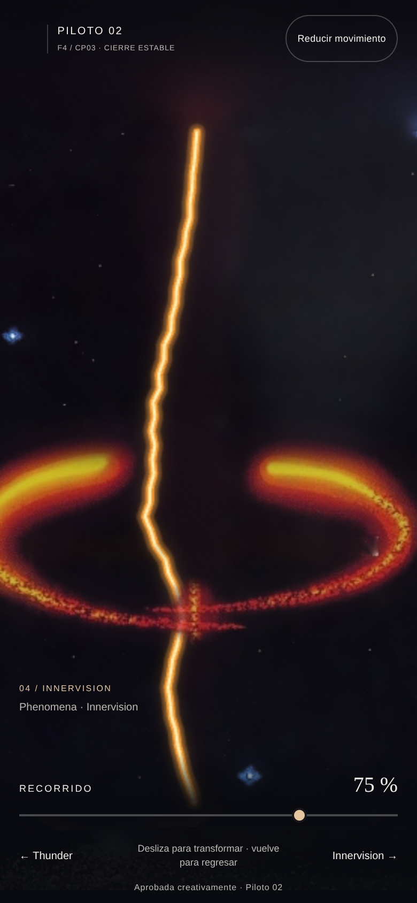

### 90 %

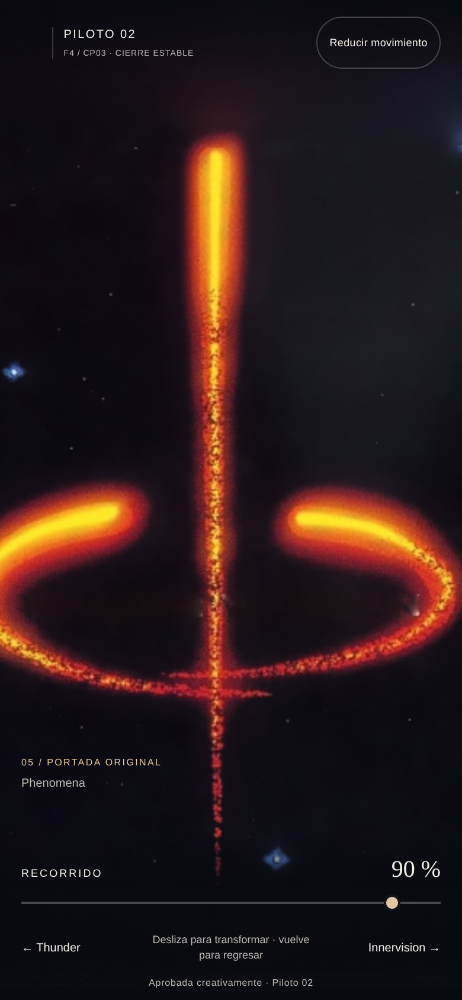

### 100 %

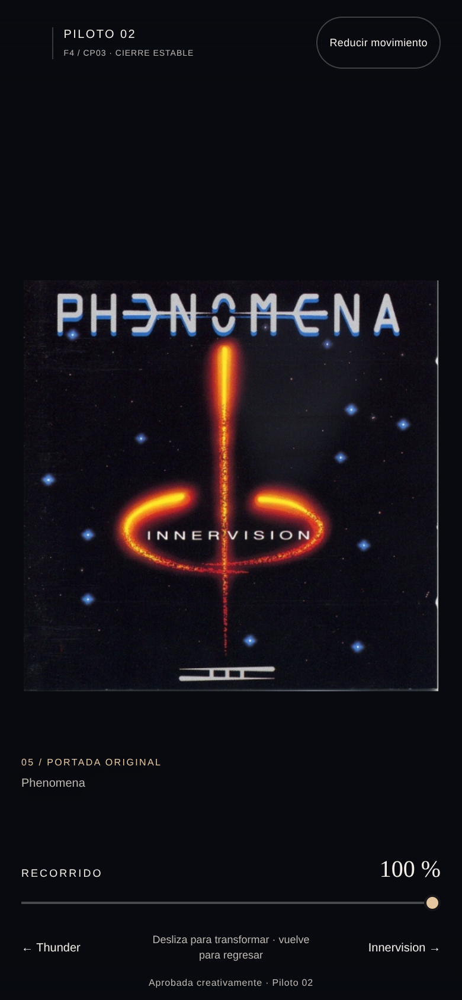

## Movimiento reducido

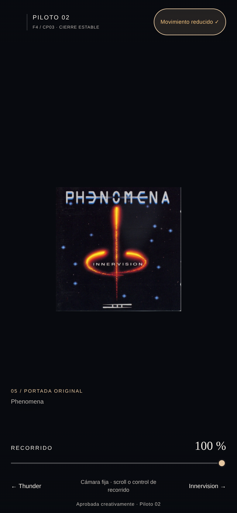

Todas las capturas individuales, resultados y registros están en [evidencias/](evidencias/).
