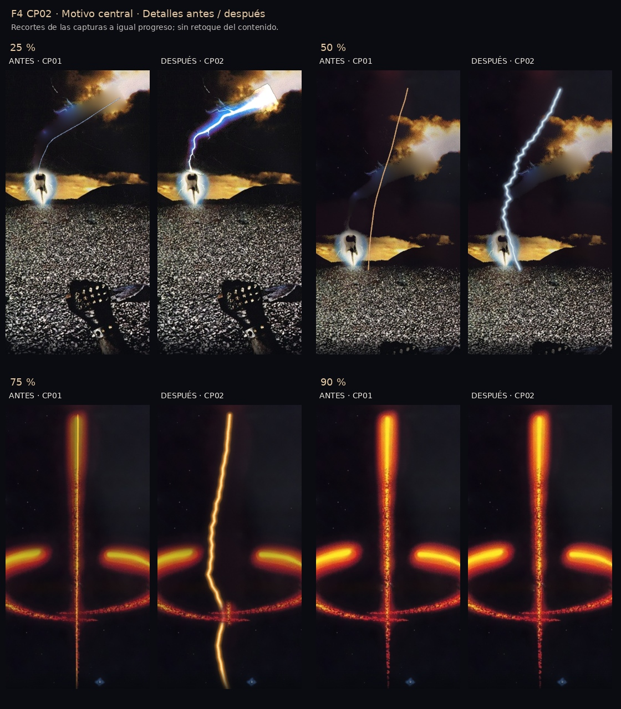

# F4 CP02 v1.1 — Corrección puntual del motivo central

**Versión funcional para revisión. No se declara aprobado ni definitivamente resuelto el ajuste.** Se conserva la transición CP01; solo cambian forma, grosor, luminosidad y relevo del motivo central. Fondo, estrellas, cámara y fuentes CP05 permanecen iguales.

## Qué cambió y cuándo

| Tramo | Motivo central |
|---|---|
| 0–28 % | Se conserva el rayo fotográfico original. Entre 10–28 % recibe una carga de luz progresiva ligada al scroll, sin parpadeo. |
| 28–46 % | Relevo gradual desde el recorte original hacia un contorno con curvas y quiebros derivados de su silueta. |
| 46–62 % | El motivo se alarga y conserva toda su irregularidad; todavía no se aplica el enderezamiento. |
| **62–90 %** | **Enderezamiento progresivo**: aún curvo al 75 %, casi alineado al 86 % y convergente con el eje al 90 %. |
| 82–90 % | El eje original de Innervision toma el relevo. El punto de encuentro con el arco se mantiene continuo. |

El cuerpo pasa de aproximadamente **1.91 a 4.08 px al 50 %**, y de **2.50 a 5.18 px al 75 %**, medidos en el lienzo fuente 1066×600. Se añade núcleo claro y halo local suave. La corrección actúa sobre el contorno y el ritmo del morphing, además del brillo. No hay pulsaciones, ruido temporal, flashes ni efectos nuevos fuera del motivo. El signo final conserva su master.

## Evidencia antes/después

- [Vídeo comparativo simultáneo](evidencias/F4_CP02_ANTES_DESPUES.mp4): mismo scroll absoluto en ambos prototipos; izquierda CP01, derecha CP02. Descargar el archivo desde GitHub para reproducirlo si no aparece un reproductor.
- [25 %](evidencias/comparativa-escritorio-p025.jpg), [50 %](evidencias/comparativa-escritorio-p050.jpg), [75 %](evidencias/comparativa-escritorio-p075.jpg), [90 %](evidencias/comparativa-escritorio-p090.jpg).
- [Capturas móviles y originales completos](evidencias/).
- [Índice local de revisión](COMPARATIVA.html), para abrir después de descargar el repositorio.

La base CP01 corresponde al commit `81a9dfbb757c5cc2b1011c0314587cb9b9d661ee`. Sus cuatro archivos de presentación y sus metadatos se conservan en `base-cp01/`; los recursos gráficos son idénticos. Los scripts de comparación reconstruyen ambos runtimes desde esos archivos sin cambiar las fuentes.

## Comprobaciones

**47 pruebas dirigidas aprobadas, 0 pendientes**; suite general consolidada **104/104**. Se comprobaron escritorio 1440×900 y móvil 390×844 emulado; la suite general también cubre móvil pequeño y horizontal.

| Progreso | Desviación máxima del motivo respecto de una recta |
|---|---|
| 50 % | 51.82 px fuente |
| 75 % | 33.61 px fuente |
| 90 % | 0.00 px fuente |

Además de inspeccionar las capturas, se midió la geometría: al 50 y al 75 % el motivo sigue curvo. Al 90 % converge al eje. Los píxeles fuera de su región son idénticos a CP01; los extremos, la escena del 90 % y todo el modo reducido mantienen sus píxeles. Se repitieron 0→60→30→60→100, la pausa en 53.7 % y 201 posiciones de scroll: sin deriva, pulsaciones ni saltos detectados. Cero errores de consola, JavaScript o carga en las comparativas finales.

Se corrigieron dos detalles durante las pruebas: una pausa de imagen al prolongar el rayo (resuelta con la carga progresiva vinculada al avance) y una desviación subpíxel del enlace final (bloqueo al eje exacto). Los diagnósticos iniciales se conservan identificados; los resultados finales están en [resultado-motivo.json](evidencias/resultado-motivo.json) y [regresion-consolidada.json](evidencias/regresion-consolidada.json). La suite general y la revalidación dirigida se distinguen en sus registros.

## Ejecutar y revisar

El código vigente sigue en `../prototipo/`. Desde la raíz del repositorio: `py piloto02-f4/prototipo/server.py` en Windows o `python3 piloto02-f4/prototipo/server.py` en macOS/Linux. Abrir `http://127.0.0.1:4173`; verificar la cabecera **F4 / CP02**. En el ZIP ligero, usar `py prototipo/server.py` desde su carpeta extraída. No ejecutar dentro del ZIP ni abrir mediante `file://`.

Para repetir la comparación técnica: `python revision-cp02/verificar_motivo.py` desde la carpeta `piloto02-f4` (dependencias de pruebas en `pruebas/requirements.txt`). Para grabar: `python revision-cp02/grabar_comparativa.py`, con FFmpeg instalado. Ninguna de esas dependencias es necesaria para ejecutar el prototipo.

**Límites:** el contorno intermedio sigue siendo interpretativo, no una restauración exacta del rayo histórico. Se conservan la resolución y las reparaciones CP05. Móvil es emulación Chromium; falta revisión física y del usuario. La captura por software limita la cadencia del vídeo y no acredita 30/60 FPS reales. La mayor organicidad está comprobada en los estados capturados; su lectura artística y el grosor final quedan pendientes de tu revisión en funcionamiento.

## Entrega verificada

El ZIP ligero CP02 se extrajo y arrancó en otra carpeta y puerto: ocho imágenes cargadas, recorrido 0→60→30→60→100 reversible y cero errores de consola/JS. También pasaron las dos comprobaciones táctiles emuladas. Vídeo H.264 de 42.8 s, 1280×500, comparación simultánea con scroll idéntico; la cadencia de captura por software no mide FPS de hardware.
